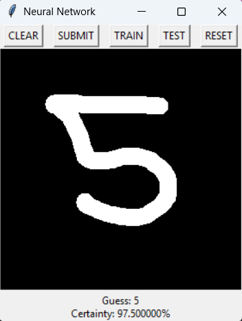

# Neural Network Digit Recogniser

A multilayer perceptron that recognises handwritten digits from 0 to 9, written in plain Python and NumPy. No machine learning libraries: forward pass, backpropagation and training are all implemented by hand.

Includes a drawing interface where you can test the network in real time with your own digits.



## Results

- MNIST test set (10,000 unseen images): ~95%
- Mouse-drawn digits: ~80% (see [Limitations](#limitations))

## How it works

### Network

Based on Michael Nielsen's multilayer perceptron:

```
Input (784) → Hidden (16) → Hidden (16) → Output (10)
```

- **Input:** a 28×28 greyscale image. Each pixel becomes a number between 0 (black) and 1 (white).
- **Hidden layers:** two layers of 16 neurons, sigmoid activation.
- **Output:** 10 neurons, one per digit. The highest one is the guess.

### Training

- Images are passed through in batches of 64.
- Each output is compared to the correct answer, and backpropagation works out how to adjust each of the network's 13,002 parameters (weights and biases).
- Parameters are updated with gradient descent, learning rate 3.
- Xavier weight initialisation stops neurons starting out saturated.

### Drawing interface (Tkinter)

1. Records your pen strokes.
2. Redraws them onto a hidden PIL image.
3. Processes that image to look like an MNIST digit: cropped, scaled to fit a 20×20 box, and centred in a 28×28 frame.
4. Passes it through the network and shows the guess.

## Setup

### Requirements

```
pip install -r requirements.txt
```

### MNIST dataset

Only needed for training and testing. **Not required for drawing digits:** trained weights are included.

Download: [MNIST Handwritten Digits Dataset](https://www.kaggle.com/datasets/ghnshymsaini/mnist-handwritten-digits-dataset)

Put the `mnist_png` folder inside the project folder, with `train` and `test` folders inside it. Each of those has one folder per digit (0 to 9).

## Usage

```
python main.py
```

- **CLEAR**: wipes the canvas
- **SUBMIT**: guesses the drawn digit
- **TRAIN**: trains for 30 epochs and saves the weights (the window freezes until it finishes)
- **TEST**: measures accuracy on the MNIST test set
- **RESET**: replaces the weights with fresh random ones

## Limitations

- **Mouse-drawn digits score lower than MNIST.** Small differences between the processed drawings and MNIST's handwritten digits, in position, stroke thickness and style, reduce accuracy. A multilayer perceptron ties each weight to one exact pixel, so it's sensitive to these.
- **"Certainty" is not a probability.** Sigmoid outputs are independent and don't add up to 100%. It shows how strongly the guessed digit matched, not how likely it is to be right.

## Possible improvements

- **Modular design:** set the number and size of hidden layers in code, or in the app.
- **Better activation functions:** ReLU in the hidden layers, softmax with cross-entropy at the output.
- **Nicer interface:** a more modern GUI library than Tkinter.
- **Convolutional neural network:** much less sensitive to where and how a digit is drawn.

## Resources

- Michael Nielsen, [*Neural Networks and Deep Learning*](http://neuralnetworksanddeeplearning.com)
- 3Blue1Brown, *Neural Networks* video series (chapters 1–4)